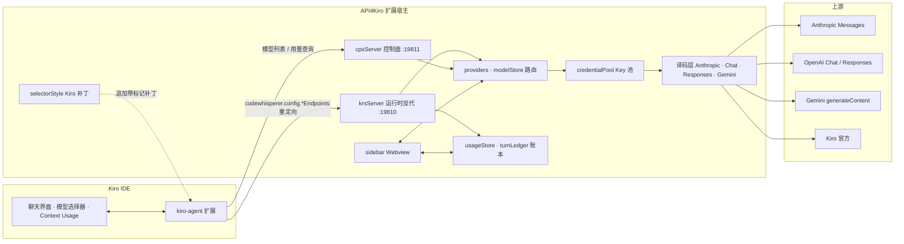
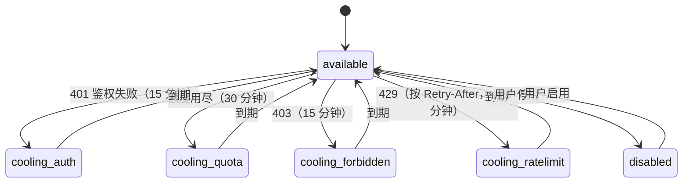

# 架构概览

本文描述 API4Kiro 的运行时结构：Kiro 的请求如何到达本扩展、如何被路由到多家上游、用量如何记账，以及为什么要给 Kiro 的前端文件打补丁。配置项参考见 [CONFIGURATION.md](CONFIGURATION.md)。

## 系统架构

- 扩展在本机回环地址起两个 HTTP 服务：**KRS**（运行时，默认 19810）承接 Kiro 的对话请求；**CPS**（控制面，默认 19811）承接模型列表、测活、用量查询。本地服务只接受本机非浏览器客户端的请求（`requestGuard.ts` 校验 `Host` 为回环地址、无浏览器来源头 `Origin` / `Sec-Fetch-Site`、TCP 远端为回环，不符一律 403 且不带 CORS 头），网页无法借用你的凭据调用；Kiro 自身走 aws-sdk 的 Node HTTP 客户端，不受影响。
- 启用代理时，扩展把 Kiro 的 `codewhisperer.config.krsEndpoints / cpsEndpoints / endpoints` 指向本地端口，并把原值备份到 `globalState`；关闭代理时复原。
- `package.json` 声明 `extensionDependencies: ["kiro.kiroAgent"]`，让 Kiro 工作台把本扩展与 kiro-agent 放进**同一个扩展宿主进程**——这是「通道 A」静默刷新能读到 kiro-agent 内部钩子的前提。
- 代理开关与含凭据 / 端点的设置项（`enabled`、`providers`、`apiKey`、`baseUrl`、`officialBaseUrl`、`officialApiKey`、`openaiBaseUrl`、`openaiApiKey`、`usagePath`）声明 `scope: machine`：工作台解析工作区 `.vscode/settings.json` 时直接跳过它们，只有用户设置生效，也不参与 Settings Sync；读取 `providers` 时扩展再用 `inspect()` 只取用户级值（纵深防御，工作区值出现时记一条 warn）。`capabilities.untrustedWorkspaces.supported: false`——受限模式（未信任）工作区下扩展不激活。

## 一次对话请求

1. Kiro 以 AWS eventstream 二进制帧向 KRS 发送 CodeWhisperer 请求（`cwTypes`），`eventstream.ts` 解码。
2. 若这是 Kiro 每轮附带的 simple-task **意图分类**请求且 `interceptIntentClassifier` 开启，`intentClassifier.ts` 本地应答，不打上游。
3. `modelStore` 按请求中的模型 ID 查路由表，找到拥有该模型的 provider；`credentialPool` 按该 provider 的策略（主备 / 均衡）挑一把可用凭证；OAuth 类凭证由 `oauth/index.ts` 在发送前换取新鲜 access token——前提是该 provider 的 `baseUrl` 宿主在厂商规格的允许集内（`providers.ts#allowedOAuthHosts`，由运行时 VendorSpec 派生；用户可用 `allowCustomHost: true` 放行自建中转），否则 token 不交出、provider 不进路由、面板与回复说明原因。
4. `imagePolicy` 检查目标模型是否在纯文本名单中，必要时剥离图片（含历史消息）。
5. 按 provider 协议译码：`translate.ts`（Anthropic）/ `openaiTranslate.ts`（Chat）/ `responsesTranslate.ts`（Responses）/ `geminiTranslate.ts`（Gemini）。思考档位由 `effort.ts` 与 `thinkingPolicy.ts` 决定字段形态；工具 schema 由 `schemaUtil.ts` 内联 `$ref`。
6. `upstream.ts` 发起流式请求；对应的 `*Stream.ts` 把上游 SSE / 类型化事件翻回 CW 事件，经 `streamShared.ts` 合成 thinking / 文本 / 工具调用，`eventstream.ts` 编码回写给 Kiro。
7. 失败处理：尚未输出任何内容时的流中断按 `autoRetry / maxRetries` 透明重发；鉴权 / 额度 / 限流类错误反馈给 `credentialPool` 标记冷却并换下一把凭证；图片被拒时把模型记入 `textOnlyModels`。
8. `turnLedger` 把一轮里的多次请求（Kiro 工具循环每次迭代都是独立 HTTP 请求）累计成一轮，轮末一次上报，Kiro 页脚显示 Est. Input / Output Tokens；`usageStore` 同时把请求写入本地账本，`contextParser` 把输入 token 按系统提示 / 历史 / 工具 / 附件等成分无损分配，供 Sankey 与 Context Usage 弹层使用。

## 模块边界

| 模块 | 职责 | 依赖 |
| --- | --- | --- |
| `extension.ts` | 激活 / 停用、命令、配置监听；providers 变化时先走通道 A，失败才提示重载 | config, endpoints, portBinder, servers, sidebar, selectorStyle, stores |
| `endpoints.ts` | Kiro 端点设置的备份 / 重定向 / 复原 | vscode globalState |
| `portBinder.ts` / `proxyIdentity.ts` | 多窗口共用端口：先到者为主实例，后到者探测端口发现是同类实例即待机；升级后旧实例被识别并让位 | net |
| `requestGuard.ts` | 两个本地服务的请求来源守卫：Host 回环、无 `Origin`、`Sec-Fetch-Site` 缺失或 `none`、远端回环才放行，否则 403（text/plain，无 CORS 头，限频记日志） | log |
| `krsServer.ts` | 运行时反代与意图分类本地应答；上游超长时回 Kiro ValidationException 触发被动压缩 | 协议模块, credentialPool, usageStore, contextParser, turnLedger, imagePolicy, contextOverflow |
| `contextWindow.ts` / `contextOverflow.ts` | 每模型挡位解析与 CPS description 往返；上游超长判定 | 无 |
| `cpsServer.ts` | 模型列表广播（把推理 / 图片能力与生效上下文窗口编码进模型 description，供选择器徽章、弹层与 Ctx 下拉读取）、测活、用量查询 | providers, modelStore, usageStore, contextWindow |
| `providers.ts` / `credentialPool.ts` | 注册表、路由、凭证调度 | oauth/tokenStore, config |
| `providerProbe.ts` | 对草稿渠道测延迟 / 拉模型 / 测活，不写注册表 | upstream, providers |
| `modelCatalog.ts` / `codexCatalog.ts` / `modelStore.ts` | models.dev 与 Codex 订阅口径目录缓存；聚合列表与路由表；学到的模型名单 | globalState, upstream |
| `oauth/` | 六家厂商登录（授权码 + PKCE / 设备码）、token 刷新与存储 | tokenStore（SecretStorage）, openBrowser |
| `ccSwitchImport.ts` / `sqliteReader.ts` | 只读解析 `~/.cc-switch/cc-switch.db` 导入渠道 | fs |
| `usageStore.ts` / `turnLedger.ts` / `contextParser.ts` | 账本、整轮累计、上下文分项 | cwTypes, promptStore |
| `promptStore.ts` | 提示词库（单条启用，注入 system） | globalState |
| `sidebar.ts` | Webview 四页模板与图表（趋势、六层 Sankey、路径条、设置页 MCP / 子代理 / 上下文卡） | 各 store, providerProbe, ccSwitchImport, mcpConfig, agentConfig, contextWindow, updateChecker |
| `mcpConfig.ts` | 直管 Kiro 两份 mcp.json：容错 JSONC、原子写、备份、监听 | fs |
| `agentConfig.ts` | 直管两级自定义 agent 文件（md / json），写回保留未知块 | fs |
| `selectorStyle.ts` | Kiro 三处靶文件的补丁 / 复原 / 漂移检测；通道 A 刷新；聊天框 Ctx 下拉与宿主转发钩子 | Kiro 安装目录文件 |
| `updateChecker.ts` | GitHub Release 更新检查与自更新（下载 vsix → 校验 → installExtension） | https |
| `eventstream.ts` / `cwEvents.ts` / `cwTypes.ts` | CodeWhisperer 协议编解码与类型 | 无 |

## Key 池状态机

- 冷却是**避让**而不是封锁：冷却中的凭证不参与调度，池里其它凭证照常服务；到期自动回池，无需人工干预。
- `priority`（主备）固定用最优先的一把，挂了才切；同一会话粘住同一把凭证 2 小时，避免同一对话在不同账号间跳。
- `least-used`（均衡）为新会话选择累计使用最少的一把。

## Kiro 前端补丁

Kiro 的模型选择器不支持分组样式，Context Usage 弹层不显示真实窗口，也没有任何命令能让 kiro-agent 重拉模型列表。为此 `selectorStyle.ts` 在 Kiro 安装目录的三处文件末尾追加带 `a2k` 标记的补丁：

| 靶文件（相对 Kiro 安装目录） | 补丁内容 |
| --- | --- |
| `extensions/kiro.kiro-agent/packages/*/dist/style.css` | 分组标题 / 卡片 / 弹层 / Ctx 下拉样式（全部限定在扩展自己的类名作用域内；CSS 只作用于同一个 webview 文档，所以逐 package 各落一份） |
| `extensions/kiro.kiro-agent/packages/*/dist/assets/mermaid-*.js` | 选择器组头 / 能力徽章渲染（1.1 选项行；1.2 模型面板行）；Context Usage 弹层改为读 description 里的真实窗口；「Ctx」挡位下拉（1.1 在 Effort 旁，1.2 在模型触发器旁） |
| `extensions/kiro.kiro-agent/dist/extension.js` | 在模型配置 provider 的 setter 上挂钩子，暴露给同宿主的本扩展，用于「通道 A」静默刷新；`a2k:ctx` 挡位转发 |

**靶点发现（1.1.14 起）**：按**内容**而不是文件名认 chunk —— Kiro 1.1.14 把聊天界面拆到 `kiro-ui-session-details`，承载模型选择器的同一个 chunk（同名 base `mermaid-GHXKKRXX`、不同 hash、大小 1.87 MB vs 2.22 MB）在各 package 下各有一份且**独立压缩**。`selectorPackages()` 先用类名字面量 `chat-input-popup-option` 筛 `mermaid-*`，该 package 一份都不命中时**回退扫全部 `assets/*.js`**（文件名是 Kiro 内部的偶然命名，换名时不该整组静默失效），随后 chunk 与同 package 的 `style.css` 逐份处理。

**1.2.56 起两代靶点**（4.13.64）：Kiro 1.2.56 把模型选择器重写成 `ModelPanel` / `ModelOptionRow` / `useModelSelector`，1.1 代锚点全部消失。`applySelectorScript` 先试 1.1 代（`applyOptionRowV1`：选项行 / 菜单 / ref），不中再试 1.2 代（`applyModelPanelRow`，v2）；两代锚点不会同时出现，1.1.x 上的行为逐字不变。v2 不改 React Compiler 的记忆化组件体，只做三处纯插入，全有或全无：

| 插入点 | 锚点 | 内容 |
| --- | --- | --- |
| 行组件函数头之后 | `function <Row>(
){`（`<Row>` 由 `<h>(<Row>,"ModelOptionRow");` 唯一反查） | `
=a2kRowFix(
);`——唯一的 hook `ne.c(47)` 调用次序不变 |
| 行组件标签之后 | `<h>(<Row>,"ModelOptionRow");` | `a2kRowFix` 定义：`__A2K_GRP__` 行换成不可交互（`aria-disabled` / `data-a2k-grp` / 阻断点击）+ 卡片头描述；`__A2K_MDL__` 行描述换成能力徽章（无徽章为空）；其余行原样返回 |
| `useModelSelector` 的 writeModel 回调头 | 唯一字面量 `},"writeModel")` 往前 400 字符内最后一个 `<x>(<g>=>{`，且紧跟 `<g>!==` | `if(typeof <g>==="string"&&<g>.startsWith("a2k-group:"))return;`——键盘 Home+Enter 也选不中分组标题 |

三段都用 `/*a2k-row:start*/…/*a2k-row:end*/` 定界，还原 = 删段（`restoreModelPanelRow`，排在 `restoreSelectorScript` 最后）。v2 不打菜单宽度 / resize / 选中居中：面板自己管宽度与 `revealRow` 滚动。「Ctx」下拉在 `EffortSelector` 标签 0 命中时改挂 `ModelSelector`（调用形状同为 `<jsx>.jsx(<fn>,{disabled:<v>})`），模板与还原正则照用。

约束与机制：

- **结构匹配，不写死压缩名**。Kiro 自动升级会改变压缩后的标识符（1.0.411 → 1.0.437 → 1.1.14 每次都重排），补丁模板把标识符换成正则捕获组按结构匹配；调用处以捕获到的名字渲染。三处靶点**全有或全无**：任一漂移或写入失败则三处都不写，不留半套。成员访问的属性名（`ne.c(30)` 的 `.c`）按字面量处理、不参与改名映射（4.13.64：1.2.56 把局部 `c` / `u` 对调，旧分词把属性 `.c` 与局部 `c` 算成同一个名字，弹层函数 0 命中）。
- **逐 package 记账，半套不许报成功**（4.13.63）。1.1.14 起同一份 chunk 在多个 package 各有一份、各自独立压缩，所以「成没成」逐份回答：任一承载 package 没打上就报 `unavailable` 并**点名**落地 / 漏掉的 package；`CARD_CSS` 也逐份决定（只给拿到补丁的那份加），一份漂移不牵连另一份，也不会留下「改了外观没功能」的半套。可选组（Ctx 下拉）同理：一份不全中就不报 `applied`。
- **连名字助手也不能写死**。`resolveTaggedName` 原先按 `a(<压缩名>,"<原名>")` 反查，而 1.1.14 的 session-details 那份是 `o(C1,"useSessionConfig")` —— 该视图的 Ctx 下拉因此整体不注入。现在先按历史形态找、不中再放宽到任意助手名（仍要求唯一命中）。
- **注入段自带标识符必须与压缩名不可能相撞**。`namesCollide` 会在真机名与模板里任一**代码**标识符同名时拒绝整条补丁（防遮蔽 / TDZ；字符串 / 注释里的词不参与判定）。所以 A2kContextSelector 模板里属于扩展自己的标识符（含内部对象键）一律 `a2k` 前缀：压缩器只产出 `a–z / A–Z / aa…` 形态，`a2k*` 永不出现。
- **原文随身**。替换函数体时把出厂原文以 base64 写进 `a2k-orig:` 块注释，复原时解码回填并校验；CSS 与选项行用锚点式复原，不依赖当前补丁串逐字匹配。写盘走原子写入。
- **触发时机**。启用代理 / 打开样式开关 / Kiro 升级覆盖后首次激活 → 打补丁并提示重载一次；关闭代理 / 关闭 `groupHeaderStyle` → 三处复原。
- **为什么窗口关闭时不复原**。kiro-agent 是本扩展的依赖，总是先激活并直接 `require` / `<link>` 磁盘上的文件；如果在 `deactivate` 里复原，下一个窗口的 kiro-agent 拿到的永远是出厂文件，钩子永远不可达。所以窗口关闭时三份文件保持补丁态；没有本扩展运行时，补丁对 Kiro 原生行为无可见影响。

「通道 A」：面板里增删模型或改顺序后，扩展通过钩子调用 kiro-agent 的模型配置刷新（`refreshWithOutcome`，退化为 `refresh`），Kiro 右侧选择器不重载即更新；钩子不可达时才退回「提示重载窗口」。

## 多窗口

多个 Kiro 窗口共用同一对端口。启动时 `portBinder` 尝试绑定；端口已被占用时用 `proxyIdentity` 握手——对方是同类实例则本窗口待机（所有窗口的请求都由主实例服务），主实例退出后待机者接管。握手比对扩展标识与版本，升级后旧实例会被识别并让位。握手两个方向都带 HMAC-SHA256 签名：密钥是同用户所有窗口共享的 `globalStorage/identity.key`（`identityKey.ts`，首个窗口独占创建），让位请求须回传服务端一次性 nonce 并签名，签名绑定端口角色（KRS / CPS 互不通用），校验不过则 403 且端口不放（4.13.53 起的主实例拒绝一切无签名让位）；新窗口探测到自报版本低于 4.13.53 的旧主实例时仍按旧协议让它让位，保证升级路径。

## 已知限制

- 只在 Kiro 内运行（依赖内置 `kiro.kiroAgent`），纯 VS Code 不激活。
- 补丁针对 Kiro 1.0.411 / 1.0.437 / 1.1.14 / **1.2.56** 的文件结构验证（`dev/verify-selector-patch.js` 对真机安装目录的只读副本跑结构命中、唯一性、改名守卫、幂等、往返复原、多 package 覆盖、弹层「命中即可见」、Ctx 下拉逐份「能注入且真能渲染」、v2 行改写与 writeModel 守卫；1.2.56 上 175 项，项数以脚本自报为准）。Kiro 大改前端结构时补丁会因靶点不匹配而整体跳过（回到原生外观，功能不受影响），需要跟进新结构——1.1.14（聊天界面拆 package + 整体重压缩）与 1.2.56（模型选择器重写为模型面板、EffortSelector 删除）各发生过一轮。
- **1.2.56 的 session-details 那份 Context Usage 弹层保持原生**：它的 jsx 运行时名是 `x`（见下一条的 `b` 守卫），模板串插值里的名字也漂了；agent-chat 那份照常注入。
- **1.1.x 本轮只有合成夹具回归**（P23：按 1.1.14 实测改名表把规范模板渲染成 1.1.x 形态，断言 v1 全链路能打上并逐字往返）。4.13.64 改到 v1 路径的只有分词（属性名按字面量），真实 1.1.14 bundle 上的回归没跑。
- 补丁认 chunk 用内容判据（`chat-input-popup-option`），文件名只在 `mermaid-*` 这一轮优先；两者都不中才会整体跳过。
- **Context Usage 弹层补丁还剩一处写死的压缩名**（选择器、Ctx 下拉与弹层的另外两处已全部结构匹配）：**jsx 运行时名**。模板与还原侧都以规范名 `b` 逐字落地，所以 `applyPopover` 先读命中段里的真机名，不是 `b` 就直接跳过（宁可这个视图退回原生外观，也不写出 `b.jsx(...)` 这种指向不存在标识符的代码）。要支持任意 jsx 名，得把真机名同时穿到写入侧与 `restorePatchedPopover` 的期望形态——只改一边会把另一种名字写进文件，比跳过更糟。
- displayName 标签的**名字助手**已按结构捕获（4.13.63）：`findPopoverFactory` 贴着命中段末尾读 `<助手>(<函数名>,"ContextUsagePopover");`，写入与还原都用真机名。此前它拿规范名 `a` 逐字比对，真机助手叫别的名字（session-details 是 `o`）时整条弹层补丁静默不注入。
- 调用处追加的 store 名（`a2kUsage`）由外层 `{…}=<hook>(n)` 绑定，出厂调用处不引用，命中段里读不出来，所以写成 `typeof n==="undefined"?void 0:n`：名字被压缩器改掉时弹层退回「无 breakdown」的原生三项视图，而不是抛 ReferenceError。`POPOVER_CALL_PATCHED_RE` 同时兼容旧形态（裸标识符），真机上已经打过的旧补丁照样能还原。
- 卸载扩展后三处 Kiro 文件保持补丁态（无可见影响）；如需彻底出厂，先关闭代理再卸载，或重装 Kiro。
- Antigravity（Google）登录的 client secret 不在公开仓库，也不进公开 Release。默认 `npm run package` 不注入；本机自用须 `A2K_EMBED_ANTIGRAVITY_SECRET=1` 或 `A2K_ANTIGRAVITY_CLIENT_SECRET`，带密钥的包不得上传。
- 更新检查依赖 GitHub API 可达；匿名请求有速率限制，失败静默。
- 回归测试套件包含 Kiro 编译产物的只读副本，未随公开仓发布。
